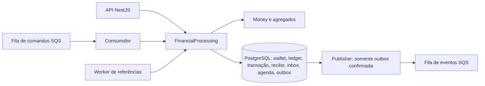

# Arquitetura

## Sistema entregue

A [T12](docs/audits/T12-corrections.md) corrigiu os três achados da auditoria T11.
Uma migration incremental audita o histórico e valida o sucessor do ledger; erros
conhecidos do parser retornam 4xx; métricas incluem todos os estados do domínio.
[ADR 0011](docs/decisions/0011-audit-corrections.md) detalha escolhas e upgrade.

O serviço processa BET, WIN, LOSS, REFUND e ROLLBACK por HTTP ou SQS, com Money
exato, ledger imutável, recibos idempotentes, inbox, outbox e referências fora de
ordem. Há quatro processos: API, consumidor, publisher e worker de referências.
Todos compartilham PostgreSQL; a mensageria local usa LocalStack.

O [enunciado no README](README.md) define os requisitos. O
[catálogo](docs/requirements.json) liga os requisitos às evidências e a
[matriz de testes](docs/test-matrix.md) distingue unidade, integração e concorrência.
O histórico de implementação permanece nos [planos](docs/index.md) e
[ADRs](docs/decisions/index.md). Esta página descreve o estado atual.

## Camadas e dependências

| Local            | Responsabilidade                                    | Dependências internas permitidas |
| ---------------- | --------------------------------------------------- | -------------------------------- |
| src/domain/      | Money, agregados, regras, estados, ledger e eventos | domain                           |
| src/application/ | Casos de uso e portas                               | domain, application              |
| src/adapters/    | HTTP, MikroORM, SQS, configuração e observabilidade | domain, application, adapters    |
| src/composition/ | Entrypoints, módulos NestJS e ligação concreta      | Todas as camadas                 |

Portas ficam em src/application/ports. Domínio e aplicação não importam pacotes
externos; tempo, identidade, hash e persistência entram por portas. Constructors
privados/protegidos e factories encapsulam estado. rehydrate restaura registros
confiáveis sem repetir transições; Money continua validando sua representação.

`bun run check:architecture` analisa a AST TypeScript: imports, reexports, tipos,
require e imports dinâmicos literais, com aliases de tsconfig. Caminhos inválidos,
imports dinâmicos calculados, ciclos e dependências proibidas falham. Esse gate
não prova correção financeira nem substitui testes com PostgreSQL/SQS.

## Dinheiro e modelo

Money é imutável e guarda centavos bigint. Contratos exigem strings canônicas com
exatamente duas casas, sem negativos, expoente, espaços ou arredondamento implícito.
BRL, USD e EUR são as moedas suportadas; não há câmbio. Operações entre moedas
diferentes falham. Contadores, versões, portas e durações podem usar number;
valores financeiros nunca passam por number.

MikroORM foi escolhido por Unit of Work e transações explícitas. EntitySchema e
mapeadores ficam separados do domínio. ExactAmountType converte strings sem perda.
O domínio SQL money_amount usa NUMERIC sem typmod: checks exigem escala até 2 e
`0 <= valor < 10^36`, evitando arredondar entradas inválidas. HTTP/SQS limitam
valores a 36 dígitos inteiros. Money puro suporta valores maiores, mas a persistência
não. Soma que ultrapasse esse limite provoca rollback, não truncamento de dinheiro.

Wallet.open cria versão 1. Saldo inicial positivo cria OPENING, crédito no ledger e
eventos na mesma transação. Abertura zero não cria movimento. Wallet.apply valida
saldo/referência e devolve ledger; LOSS e rejeições não alteram saldo/versão nem
produzem ledger. Ledger é estruturalmente imutável no domínio e protegido no banco.

As decisões estão nos ADRs [0004](docs/decisions/0004-financial-domain.md) e
[0005](docs/decisions/0005-schema-persistence.md).

## Transação financeira e concorrência

FinancialProcessing.process é compartilhado por HTTP e SQS. Cada execução usa um
EntityManager próprio e READ COMMITTED. A sequência principal é:

1. Para SQS, inserir/obter inbox e bloquear consumerName/messageId; conferir hash.
2. Procurar recibo idempotente. Se existir, devolver a resposta original.
3. Bloquear a wallet com FOR UPDATE antes de reidratar seu saldo; consultar recibo novamente.
4. Validar operação e referência, aplicar movimento ou registrar rejeição/pendência.
5. Persistir transação, saldo/versão, ledger, recibo, agenda quando necessária e outbox.
6. Completar inbox, executar flush/commit e somente então devolver resposta ou ack.

Uma falha em flush ou commit reverte o conjunto. Não há read/calculate/update sem
lock, lock global ou garantia baseada em Map/cache. Maps do adapter só associam
objetos à unidade de trabalho atual. Wallets diferentes progridem independentemente.
Após esperar um lock, READ COMMITTED e refresh observam o saldo confirmado anterior.

O schema aplica unicidade de player/moeda, identidade provider/ID externo,
idempotency key global, ledger por transação/wallet e wallet/versão, inbox e reversão
por referência/tipo. Checks e triggers diferidos conferem não-negatividade, referências,
estados terminais, cadeia de saldos e correspondência wallet/ledger no commit.
Update/delete/truncate de ledger e mutações indevidas de registros protegidos falham.
Administradores capazes de desativar triggers continuam fora dessas garantias.

Foi escolhido lock pessimista para simplificar disputa de saldo e rejeição determinística.
A contrapartida é serializar a wallet muito disputada; não há meta de throughput.
Inbox/referências usam lock_timeout de 2 s e statement_timeout de 5 s. O caminho
financeiro HTTP não impõe esses mesmos limites de espera. Timeout/deadlock é erro
transitório, não rejeição por saldo. A estratégia está no
[ADR 0006](docs/decisions/0006-transactional-processing.md).

## Idempotência, HTTP e consultas

processing_receipts guarda identidade, hash e resultado original, inclusive saldo,
versão, status e failureCode. É imutável, sem expiração automática, e confirma junto
dos efeitos. Unique constraints resolvem disputas entre wallets: a operação perdedora
reverte e consulta o recibo confirmado para decidir conflito ou replay.

O hash financeiro é SHA-256 de JSON com chaves ordenadas recursivamente: providerId,
externalTransactionId, walletId, playerId, roundId, gameId, kind, money(amount/currency)
e referenceExternalTransactionId quando presente. Header e metadados não entram.
HTTP exige um único Idempotency-Key; campo no body, extras e OPENING externo são recusados.
Mesma chave com payload diferente, ou outra chave para a mesma identidade externa,
são conflitos. Recibos não são inventados para registros legados sem resposta original.

Replay mantém a resposta inicial, mesmo quando GET já mostra resolução de uma
PENDING_REFERENCE. Cursor do ledger é base64url versionado, vinculado à wallet,
ordenado por walletVersion e com teto da primeira página. Novos movimentos exigem
nova paginação. Limite 1–100, padrão 50; cursor não é assinatura nem autorização.

HTTP: 201 criação/aplicação, 200 consulta/replay aplicado, 202 pendência, 400 entrada
inválida, 404 ausência, 409 conflito, 422 rejeição, 503 infraestrutura transitória
com Retry-After e 500 falha inesperada. Códigos são estáveis; SQL/payload/stack não
são devolvidos. Contratos, exemplos e replay estão no [runbook HTTP](docs/runbooks/http.md)
e no [ADR 0007](docs/decisions/0007-idempotency-http.md).

## Referências, estados e interpretações

| Tema                                | Decisão adotada                                                                                                                                                                    |
| ----------------------------------- | ---------------------------------------------------------------------------------------------------------------------------------------------------------------------------------- |
| Valores zero                        | LOSS exige zero; BET/WIN/REFUND/ROLLBACK exigem positivo; abertura admite zero.                                                                                                    |
| Referências                         | REFUND/ROLLBACK exigem referência; WIN pode referenciar BET; BET/LOSS não aceitam referência.                                                                                      |
| Escopo                              | Mesmo provider, player, wallet, moeda e rodada. gameId não é restrição adicional do enunciado.                                                                                     |
| Reversão                            | Valor integral; REFUND aceita BET, ROLLBACK aceita BET/WIN/REFUND. A unicidade é por referência/tipo: REFUND e ROLLBACK podem reverter a mesma BET uma vez cada, conforme seção 7. |
| Referência existente não processada | Rejeição REFERENCE_NOT_PROCESSED; não há ordenação de cadeias pendentes.                                                                                                           |
| Referência ausente                  | PENDING_REFERENCE com agenda persistida e evento.                                                                                                                                  |
| Prazo                               | Espera inicial 1 s, backoff exponencial até 60 s e TTL de 24 h desde createdAt. Expiração rejeita com REFERENCE_NOT_FOUND e grava evento.                                          |
| Falha de infraestrutura             | Rollback e erro/retry/DLQ. O domínio/schema suportam FAILED, mas adapters não fabricam uma transação FAILED quando não conseguem confirmar a escrita.                              |

PENDING pode ir para PENDING_REFERENCE, PROCESSED, REJECTED ou FAILED.
PENDING_REFERENCE pode permanecer pendente ou terminar nos mesmos estados terminais.
PROCESSED, REJECTED e FAILED não mudam novamente. A
[taxonomia de falhas](docs/decisions/0004-financial-domain.md#códigos-de-falha)
distingue saldo insuficiente de aposta e de reversão, além de escopo, moeda e referência.

reference_jobs mantém próxima tentativa, expiração, contador e contexto. O worker
seleciona trabalho devido bloqueando a wallet com SKIP LOCKED antes da agenda;
atualiza efeitos e conclusão atomicamente. Tentativa ainda sem referência só altera
agenda. Há rodadas de até 100 tentativas e pausa de 500 ms. SIGTERM aguarda trabalho
atual; SIGKILL libera locks por rollback. Ver [ADR 0008](docs/decisions/0008-pending-references.md).

## SQS, inbox, outbox e recuperação

Há três filas FIFO: wager-transactions.fifo, wager-transactions-dlq.fifo e
wager-events.fifo. consumerName é wager-transactions-v1. Hash da inbox cobre o
envelope canônico completo; reutilizar messageId com conteúdo diferente é conflito.
Isso é distinto do hash financeiro, que só cobre negócio.

Consumidor faz long polling de 2 s, recebe um item por rodada e renova visibilidade
30 s a cada 10 s. Resultado financeiro, rejeição, pendência e replay recebem ack
após commit. Entrada permanente vai à DLQ; falhas transitórias usam visibilidade
1/2/4/8 s e quinta falha encaminha à DLQ. Redrive nativo cobre mortes sem tratamento.
Envio à DLQ precede delete; não há atomicidade entre filas. SIGTERM cancela polling
e conclui trabalho em curso ou devolve visibilidade; se a infraestrutura impedir,
a expiração permite redelivery. Compose concede 60 s ao consumidor/publisher.

PublishOutbox seleciona somente eventos financeiros confirmados, com FOR UPDATE
SKIP LOCKED. Mantém lock da linha durante envio limitado pelo SDK; não bloqueia wallet.
Depois marca publishedAt. Falhas persistem retry de 1 s até 60 s, sem descarte por
limite de tentativas. Simplicidade e recuperação automática de posse custam uma
conexão durante a rede. O SDK admite até três tentativas, com 3 s de conexão e 5 s
por requisição; esses limites não são uma duração máxima única da operação.

Morte após send antes do commit de publishedAt pode duplicar publicação. O envelope
e eventId permanecem estáveis. FIFO só otimiza deduplicação; assinantes precisam de
inbox por eventId e efeito na mesma transação. Esse contrato é testado com PostgreSQL,
mas não há assinante de negócio adicional implantado. Publishers podem entregar
eventos da mesma wallet fora da ordem de criação; walletVersion ajuda consumidores.

Envelopes vêm de subclasses de IntegrationEvent com tipo/versão fixos e payload
imutável MoneyProps. Há Processed (inclusive LOSS), Rejected, PendingReference e
BalanceChanged somente em movimento. Detalhes no [ADR 0009](docs/decisions/0009-sqs-inbox-outbox.md).

## Reconciliação e observabilidade

Reconciliação usa uma consulta SQL com snapshot único para saldo e soma assinada do
ledger. Money calcula armazenado menos calculado. Retorna consistência e quantidade
de lançamentos; divergência gera log/métrica sem reparo silencioso.

Logs financeiros JSON têm contexto de correlação e campos permitidos; não incluem
saldo, payload completo, chave/hash, SQL ou segredos. X-Correlation-Id é devolvido.
Métricas Prometheus têm labels finitos: status, replay, retries, DLQ, locks, outbox lag,
latência e reconciliação. Contadores/histogramas são locais e reiniciam com o processo;
queda após commit pode perder uma observação. Ledger/recibos são a autoridade.
Gauges globais SQL não devem ser somados entre instâncias; DLQ é aproximada.

API e workers expõem liveness, readiness PostgreSQL/SQS e metrics. Workers usam
METRICS_PORT, padrão 9464; --once não abre listener. Probes têm limites próprios;
readiness não confirma migrations nem backlog vazio. Falha de coleta responde 503,
sem zeros artificiais. Ver [ADR 0010](docs/decisions/0010-reconciliation-observability.md)
e [operação](docs/runbooks/observability.md).

## Autenticação e autorização

Autenticação foi omitida conforme seção 2 do README. OpenBusinessAccessGuard é o
ponto de extensão explícito; endpoints financeiros estão abertos e não há isolamento
entre usuários. Health permanece público. Não há tabela de credenciais artesanais.

O desenho para implantação autenticada é integrar IdP OIDC/JWT: validar issuer,
audience, assinatura e expiração; mapear identidade a provider/players e autorizar
wallets também nas consultas. providerId recebido não comprova identidade. SQS é
canal interno e preserva validações de domínio. Esse desenho não está implementado.

## Operação, limites e evidências

- Migrations versionadas são explícitas e reversíveis com proteção contra perda
  incompatível de auditoria. Inicialização HTTP não atualiza schema. Ver
  [persistência](docs/runbooks/persistence.md) antes de executar down.
- PostgreSQL tem volume local; LocalStack não persiste filas/mensagens entre recriações.
  Recriar fila vazia não recupera eventos já marcados publishedAt. Source/eventos têm
  retenção de quatro dias; DLQ de 14. Não há retenção/expurgo automático de recibos,
  inbox, ledger e outbox no banco, nem redrive automático da DLQ.
- Ambiente local usa portas em loopback e credenciais públicas de desenvolvimento.
  SQS_ENDPOINT aceita somente HTTP local. LocalStack Community fixado dispensa conta;
  limitações da distribuição estão no [ADR 0003](docs/decisions/0003-backend-foundation.md).
- Não há partidas dobradas, carga/benchmark, dashboard/OTel, backup/restore, garantia
  de throughput, múltiplos hosts ou homologação AWS. Não se promete exactly-once do
  transporte ou sobrevivência a perda de disco/broker recriado.
- Testes reais exercitam três processos, 50 duplicatas, disputa de saldo, rollback,
  desordem, SIGKILL e restart. Barreiras de falha existem somente em tests. A
  [matriz](docs/test-matrix.md) e a [auditoria](docs/delivery-review.md) registram
  evidências e limites. CI configurada e validação local são estados distintos.

Setup está no [README](README.md#executar-o-projeto); reprodução isolada está no
[runbook de entrega](docs/runbooks/delivery.md).
